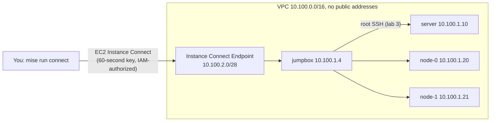

# kthw-on-floci

Do [Kubernetes The Hard Way](https://github.com/kelseyhightower/kubernetes-the-hard-way) (KTHW) on your own computer, on machines built the way a security reviewer would want them built on AWS, without an AWS account.

[floci](https://github.com/floci-io/floci) is a local AWS emulator whose EC2 instances are real Linux machines (Docker containers running systemd). One `terraform apply` creates KTHW's four Debian 12 machines (`jumpbox`, `server`, `node-0`, `node-1`) in a private VPC. You connect with `aws ec2-instance-connect ssh`, as you would on AWS, then follow the tutorial from lab 2 as written. The same Terraform applies unchanged to a real AWS account.

This repo builds infrastructure only. The tutorial is Kelsey Hightower's, and you follow it on his site.

## What you get



- **No public addresses and no SSH keys to manage.** The only way in is the EC2 Instance Connect Endpoint, with a key that lives 60 seconds.
- **Lab 3's root SSH, done safely.** The jumpbox's root key reaches the other machines (key only, never a password), `known_hosts` is filled from host keys the machines published themselves, and `/root/machines.txt` is written. Keys are exchanged as public halves through SSM Parameter Store, so no private key is ever in Terraform state.
- **Hardened as for production:** IMDSv2 only, encrypted volumes with a customer-managed KMS key, VPC flow logs, a deny-all default security group, tiered security groups, one least-privilege IAM role per machine, and an account baseline (CloudTrail, AWS Config, GuardDuty, Security Hub with CIS and NIST 800-53).
- **Measured, not assumed.** [GAPS.md](GAPS.md) lists every way floci differs from AWS here, quantified. [docs/exceptions.md](docs/exceptions.md) lists every deliberate departure from FedRAMP Moderate, from the tutorial and from this repo, with its remediation. [docs/adr/0001-kthw-on-floci.md](docs/adr/0001-kthw-on-floci.md) has the reasoning.

## Quick start

You need Docker (OrbStack on macOS is tested), [mise](https://mise.jdx.dev), and about 6 GB of free memory.

```sh
mise trust && mise install   # pinned Terraform, tflint, checkov
mise run doctor              # checks this machine can run the machines
mise run up                  # builds the images and starts floci (first time: see below)
mise run bootstrap           # the Terraform state bucket and its KMS key
mise run baseline            # optional: the account security baseline
mise run apply               # the VPC and KTHW's four machines; returns when they are ready
mise run connect             # a shell on the jumpbox
```

The first `mise run up` clones [allensanborn/floci](https://github.com/allensanborn/floci) at a pinned commit and builds floci from source in Docker (a JDK build: several minutes, and it needs github.com). Later runs reuse the image while its commit label matches the pin in `scripts/floci-image.sh`.

These links and `mise run test:kthw` use KTHW commit [`52eb26d`](https://github.com/kelseyhightower/kubernetes-the-hard-way/tree/52eb26dad1a3e9e8083a899bc854421eb4842a73), the one tested here. Lab 2 clones `master` with `--depth 1`; to match, run this after the clone (the test does the same):

```sh
git -C kubernetes-the-hard-way fetch -q --depth 1 origin 52eb26dad1a3e9e8083a899bc854421eb4842a73
git -C kubernetes-the-hard-way checkout -q FETCH_HEAD
```

On the jumpbox, become root, and start KTHW at [lab 2](https://github.com/kelseyhightower/kubernetes-the-hard-way/blob/52eb26dad1a3e9e8083a899bc854421eb4842a73/docs/02-jumpbox.md):

```sh
sudo -i
```

In [lab 3](https://github.com/kelseyhightower/kubernetes-the-hard-way/blob/52eb26dad1a3e9e8083a899bc854421eb4842a73/docs/03-compute-resources.md):

- `machines.txt` is ready: `cp /root/machines.txt ~/kubernetes-the-hard-way/`.
- Root SSH is already enabled, so skip "Enable root SSH Access" and "Generate and Distribute SSH Keys".
- Do the "Hostnames" and "Host Lookup Table" sections as written.

Then follow labs 4 to 12 as written.

To stop for the day, `mise run down`: the machines stop and keep their disks, and `mise run up` starts them again. When you are done, `mise run destroy` deletes them.

After the floci image changes (a new pinned commit), the running machines lose their metadata service ([GAPS.md](GAPS.md#compute-and-storage), `floci-5fbo.36`): run `mise run destroy` and `mise run apply` before continuing.

### Upgrading a cluster made before 2026-10-19

Terraform now owns the four SSH key parameters under `/kthw/`; before `4abee99` the machines created them at runtime. Delete them once, from `mise run console` (with the same `KTHW_TARGET`), before your next `mise run apply`, or it fails with `ParameterAlreadyExists`:

```sh
aws ssm delete-parameters --names /kthw/jumpbox/root-ssh-public-key \
  /kthw/hosts/server/ssh-host-ed25519-key /kthw/hosts/node-0/ssh-host-ed25519-key /kthw/hosts/node-1/ssh-host-ed25519-key
```

## Where the tutorial would fail a review

KTHW optimizes for learning. These steps stay, because the tutorial needs them, each with its remediation in [docs/exceptions.md](docs/exceptions.md):

| KTHW does | Why it fails review | Production does instead |
|---|---|---|
| Root SSH between machines (lab 3) | AC-6 least privilege, IA-2 accountability | Named users with `sudo` and short-lived keys, as you use to reach the jumpbox |
| A hand-made CA whose key sits on the jumpbox (lab 4) | SC-12 key management | A managed CA with KMS- or HSM-backed keys |
| Private keys and kubeconfigs copied with `scp` (labs 4 to 6) | IA-5, SC-28 | Short-lived credentials from an identity provider |
| Pre-release containerd, runc and etcd (lab 2's downloads) | SI-2, CM-2 | Released, patched versions |

This repo's own departures are numbered there too. Two matter to anyone reusing it: the root-SSH trust anchor is an SSM parameter, so whoever may write it and use the cluster key can add a root key to every cluster member (E-16), and every AWS call uses the standard, not FIPS 140, endpoints (E-17).

## Testing

- `mise run test:kthw` runs the whole tutorial on the machines: every lab's commands as written, from a pinned commit, through the same EC2 Instance Connect path you use. It then checks that both nodes are Ready, that secrets are encrypted in etcd, and that nginx answers through a NodePort on both nodes. This is the project's test that the promise holds, not a way to skip the tutorial.
- `mise run plan` exits 0 when nothing would change; on floci it does right after an apply.
- `mise run prowler` runs Prowler's FedRAMP Moderate (Rev4, the only FedRAMP framework Prowler has), NIST 800-53 Rev5 and CIS 7.0 frameworks against the target, in one region. The [documented exceptions](docs/exceptions.md) are muted by number in `compliance/prowler-mutelist.yaml`. On floci, FedRAMP and NIST each fail one row, `cloudtrail_cloudwatch_logging_enabled`, a known floci gap; CIS 7.0 still has 6 failing checks to fix or document (`kthw-q85.17`).
- `mise run lint` runs `terraform fmt` and `validate`, tflint with the AWS ruleset, the offline guards, and checkov. The guards (`workload/tests/`, `account-baseline/tests/`, `scripts/check-boot-order.sh`) keep in place the fixes floci cannot exercise because it does not route, enforce KMS or bucket policies, or deliver logs: Terraform-owned SecureString key parameters, stopping a machine before detaching its volume, the partition's SSM endpoint, SSE-S3 access-log buckets, the Config role's audit-key grant, the audit buckets' source and path denies, and machines waiting for the NAT gateway. They use a mocked provider: no credentials, no emulator. They prove the configuration, not AWS's behaviour; that is `kthw-q85.16`. Every resource written in this repo passes checkov in all three roots, and every suppression is written next to its resource with its reason. The cloudposse modules' own resources in `account-baseline` are scanned too, but report-only: its findings are still to triage (`kthw-q85.19`).

## Real AWS

The same roots apply to an AWS account with your credentials. Copy `backends/aws.s3.tfbackend.example` to `backends/aws.s3.tfbackend` and fill it from `bootstrap`'s outputs, then:

```sh
KTHW_TARGET=aws mise run bootstrap
KTHW_TARGET=aws mise run apply
```

`connect`, `console`, `test:kthw` and the wait in `apply` then run the console container with your AWS environment (`AWS_PROFILE`, region and key variables) and `~/.aws` mounted read-only, and nothing of floci's.

This costs money: a NAT gateway, four small instances, KMS keys and, with `baseline`, CloudTrail, Config, GuardDuty and Security Hub. floci is the default target; a real account is used only when `KTHW_TARGET=aws` is set. Not yet run against AWS (`kthw-q85.16`).

## Platforms

| Platform | Status |
|---|---|
| macOS arm64, OrbStack | Tested |
| macOS, Docker Desktop | Not yet tested |
| Windows, WSL2 | Not yet tested |
| Linux | Not yet tested |

`mise run doctor` names the check a platform fails.

## The floci it runs on

The features this needs are in a stack of branches on [allensanborn/floci](https://github.com/allensanborn/floci), each headed for an upstream pull request ([GAPS.md](GAPS.md#fixed-in-the-floci-stack) lists them). Until a floci release has them all, `floci/compose.yaml` runs an image built locally from that stack at the commit pinned in `scripts/floci-image.sh` (ADR decision 16, amended 2026-10-19).

## Licence

Apache-2.0 for this repository's code. Kubernetes The Hard Way is © Kelsey Hightower, licensed CC BY-NC-SA 4.0. This repo links to it and never copies it.
