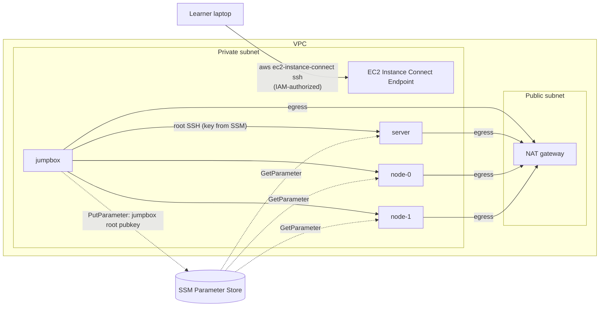

# ADR 0001: Kubernetes The Hard Way on floci, held to a FedRAMP Moderate bar

- **Status:** accepted
- **Date:** 2026-10-15
- **Decided by:** Allen Sanborn, through a structured design interview (2026-10-14 to 2026-10-15)
- **Tracking:** beads epic `kthw-q85` (this repo), `floci-5fbo` (floci work)

## Context

[Kubernetes The Hard Way](https://github.com/kelseyhightower/kubernetes-the-hard-way) (KTHW) asks for four Debian 12 machines: `jumpbox`, `server`, `node-0`, `node-1`. The learner then bootstraps Kubernetes by hand across labs 4–13. [floci](https://github.com/floci-io/floci) is an open-source local AWS emulator whose EC2 instances are real Docker containers. This repo connects the two. A learner runs `terraform apply` and gets KTHW's machines "as if on AWS", built the way a security reviewer would want AWS built, at no cost and on their own computer.

**North star:** improve floci, and let learners follow AWS best practice while doing KTHW. The bar is a strong certification standard, specifically FedRAMP Moderate.

**Standing rule.** Any bad practice that is core to the tutorial defers to the tutorial's ease of use. Each one, though, must be documented with remediation steps. Gaps, whether floci-vs-AWS or security, are acceptable only if documented **and** quantified.

## Decisions

### Scope and promise

1. **Infrastructure only (labs 1–3).** KTHW is the lesson and floci is free hardware. Labs 4–13 stay as Kelsey wrote them, linked and never vendored (the tutorial text is CC BY-NC-SA 4.0).
2. **The machines must be KTHW-capable.** Labs 4–12 must work as written. A full automated KTHW run proves it on every release candidate. That run is a test and is never shipped as learner automation. When a lab fails, the fix goes into the infrastructure, never into the tutorial text.

### Topology and access

3. **Every instance is private.** The four instances sit in private subnets behind a NAT gateway. The public subnet holds only the NAT. Security groups are tiered. *(This amends an earlier choice of a public bastion.)*
4. **Humans connect through EC2 Instance Connect Endpoint (EICE).** The command is `aws ec2-instance-connect ssh --instance-id <jumpbox>`. There are no public IPs, no key-pair fallback, and no toggle. The same Terraform works on real AWS today. On floci it depends on new floci features (decision 16). *(Amended 2026-10-16:)* the endpoint lives in its own /28, so its interface can never take an address the machines are pinned to. On floci the AWS CLI's tunnel needs port 443 and an OS-trusted CA, so learners run the CLI from a console container (`mise run connect`) that trusts floci's CA in its own store; the host's trust store is never changed.
5. **Root SSH follows lab 3's "already enabled" branch.** Instances ship with `PermitRootLogin prohibit-password` (key only, never a password), hostnames set, and `machines.txt` rendered, so the learner takes lab 3's documented skip branch. This is the first documented exception (AC-6, IA-2).
6. **The jumpbox key never enters Terraform state.** The jumpbox generates its own root key at first boot and publishes the public half to SSM Parameter Store. Each node installs it through a least-privilege instance profile, reading one parameter ARN. If floci breaks this chain, the fallback is `tls_private_key`, documented and quantified.
7. **Floci security-group enforcement is a switch, default off.** Floci's enforcement mode drops `--privileged`, and kubelet needs it. Turning enforcement on is a gap-finding mode, not the learner default.

### Code layout

8. **Three roots:**
   - `bootstrap/`: the state bucket and KMS key. It keeps local state, holds no secrets, and is the one documented state exception.
   - `account-baseline/`: CloudTrail, Config, GuardDuty, Security Hub, the password policy, default EBS encryption and S3 Block Public Access. Always applied on floci. On real accounts it's opt-in for fresh accounts, with its cost stated.
   - `workload/`: the KTHW machines.
9. **`workload/` is plain, clean-room `aws_*` resources** (about 35 of them), every line readable by a learner and an assessor. **`account-baseline/` composes [cloudposse](https://github.com/cloudposse) modules** (`terraform-aws-cloudtrail`, `-cloudtrail-s3-bucket`, `-config`, `-guardduty`, `-security-hub`), pinned to exact versions plus the lock file. Each module's defaults are checked against the bar, and overridden explicitly where they fall short.
10. **State uses the S3 backend on both targets:** SSE-KMS, versioning, Block Public Access, a TLS-only policy, and S3 native locking (`use_lockfile = true`, no DynamoDB).
11. **The same code applies to real AWS unchanged.** Only the provider endpoint and the AMI lookup differ.

### Operating system and floci fixes

12. **Debian 12, as KTHW specifies.** A Debian 12 systemd guest image is built in this repo first and upstreamed to floci's AmiImageTool. The local build is deleted once a floci release ships it.
13. **Lab 9 needs four guest fixes, proven by [spike 01](../../spikes/01-node-capability/RESULTS.md) and [spike 02](../../spikes/02-ebs-containerd/RESULTS.md):**
    - a dedicated encrypted EBS volume per node, mounted at `/var/lib/containerd` by a boot unit in the image. Floci ≥ 2.2.0 attaches EBS as real block devices, so this needs no floci feature, and it's the same layout as on real AWS. *(Amended 2026-10-16: replaces a proposed per-AMI `volumes:` catalog field.)*
    - a read-only `/lib/modules` bind
    - un-binding Docker's `/etc/hostname` and `/etc/hosts` at boot
    - a DMI `board_asset_tag` identity overlay for the EIC agent

    Running the full tutorial found a fifth, in floci rather than the guest: systemd guests must get a private cgroup namespace (as kind's nodes do), or two nodes' kubelets share one `kubepods.slice` and tear down each other's pods (`kthw/08`). Floci's remaining EBS gaps (no launch-time data volumes, Xen-style device names, world-writable device nodes, cross-instance loop-device visibility, no at-rest encryption, no hotplug events) are logged in `GAPS.md`, not built.
14. **EC2 Instance Connect is implemented in floci so that the *unmodified* AWS agent passes.** That means: `SendSSHPublicKey`; the IMDS `managed-ssh-keys` paths; a CA → intermediate → signer chain with RSA-PSS signatures and OCSP staples; DMI identity; and the agent plus floci's CA baked into the image. EICE (the resource plus its SigV4 WebSocket tunnel) comes after EIC.
15. **Floci fixes live as one linear stack of branches** in the fork ([allensanborn/floci](https://github.com/allensanborn/floci)), with true dependencies ordered (DMI identity → EIC → EICE). Each upstream PR is cut by rebasing its branch onto `upstream/main`. Fork PRs can't target fork branches upstream, so no merge order is forced. KTHW branches take upstream PR slots first.
16. **Distribution is a temporary image channel.** The fork publishes `ghcr.io/allensanborn/floci:<upstream-version>-kthw.<n>` (multi-arch, SBOM, provenance), and this repo pins it **by digest**. The Debian image ships the same way. All builds are `workflow_dispatch` only. **Exit condition:** once an upstream floci release contains every feature used, switch to `floci/floci:<version>@sha256:…` and retire the channel.

### Compliance bar

17. **FedRAMP Moderate (NIST 800-53 Rev5 Moderate), measured two ways:**
    - **Statically:** checkov and tflint (AWS ruleset) on the Terraform.
    - **At runtime:** [Prowler](https://github.com/prowler-cloud/prowler), using its `fedramp_moderate_revision_4`, `nist_800_53_revision_5` and latest CIS AWS frameworks, run against **both real AWS and floci**.

    Pass means zero failures, or each failure maps to a documented, quantified exception with remediation. **Any finding that differs between the AWS run and the floci run is a floci gap.** This repo never claims to be "FedRAMP certified": FedRAMP authorizes cloud services, not repositories. The claim is control alignment with machine-generated evidence. The evidence matrix follows the shape of Gruntwork's public [traceability matrix](https://docs.gruntwork.io/guides/build-it-yourself/achieve-compliance/traceability-matrix).

### Oracles: proving floci correct from several directions

18. Before floci features are built, independent public projects must exercise the same AWS behaviour. If floci passes them unchanged, it's correct from that project's point of view.

| Area | Oracles |
|---|---|
| EIC wire format and clients | botocore `ec2-instance-connect/2018-04-02` model; aws-cli v2 functional tests; [mssh](https://github.com/aws/aws-ec2-instance-connect-cli) |
| EIC guest agent | [aws/aws-ec2-instance-connect-config](https://github.com/aws/aws-ec2-instance-connect-config), run unmodified |
| EICE | terraform-provider-aws `TestAccEC2InstanceConnectEndpoint_*`; aws-cli `customizations/ec2instanceconnect` (tunnel) |
| Bastion, VPC, NAT, IMDSv2, EBS | [aws-samples/secured-bastion-host-terraform](https://github.com/aws-samples/secured-bastion-host-terraform); terraform-aws-modules `vpc` and `ec2-instance`; aws-ia `terraform-aws-vpc` |
| Account baseline | cloudposse module terratest suites; Gruntwork module test suites (commercial and private, so read and run as oracles only, never vendored or linked) |
| Compliance | Prowler, AWS vs floci |

No public project combines KTHW with hardened infrastructure, and no public project tests SSM key exchange between instances end to end. This repo becomes the oracle for both.

### Testing, CI, platforms, tracking

19. **Testing:** `mise run test:kthw` runs the full KTHW run on floci locally; `mise run test:kthw-aws` runs against real AWS, locally only (CI never holds AWS credentials). CI runs static checks automatically on PRs (fmt, validate, tflint, checkov), and the full run on manual dispatch only.
20. **Platforms, in order:** OrbStack (macOS arm64) → Docker Desktop (macOS) → WSL2 → Linux. `mise run doctor` preflights the host. Each unsupported platform is documented with the specific check it fails.
21. **Gap flow:** this repo is shaped so floci-harness can sweep it (it honours `AWS_ENDPOINT_URL` and pins its toolchain). Gaps that return 200 but behave wrongly, which the harness can't measure, go in `GAPS.md`, each linking its floci issue.
22. **Tracking:** `kthw-` beads here, `floci-` beads for floci work, cross-linked both ways.
23. **License:** Apache-2.0 for this repo's code. A thin pointer lab in floci-labs may follow, once this works end to end.

## Topology

## Consequences

- The first learner release waits on the floci EIC and EICE features (`floci-5fbo.6`, `floci-5fbo.7`). Infrastructure work on real AWS can proceed in parallel, since EIC and EICE already work there.
- Three to five documented exceptions are expected from KTHW itself: root SSH between machines, a static CA generated by hand in lab 4, and secrets written into local files in lab 6. Each one gets a remediation section.
- Floci gains capabilities that help any systemd-guest user, not only KTHW learners: hostname handling, kernel modules, nested containers and instance identity.
